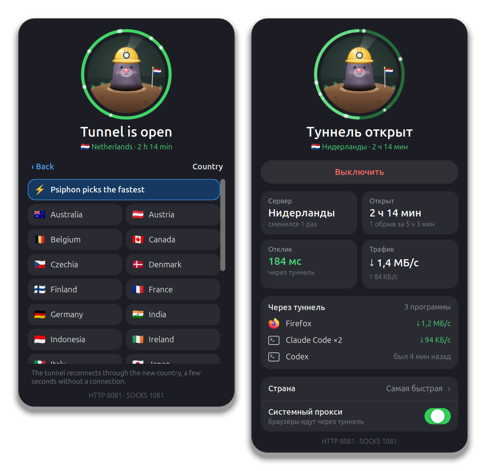

# Psiphon Tunnel

[](https://github.com/lilter96/gnome-psiphon-tunnel/actions/workflows/test.yml)

A GNOME Shell extension that puts the [Psiphon](https://github.com/Psiphon-Labs/psiphon-tunnel-core)
console client in the top bar, with an installer that sets up Psiphon itself
and a pair of terminal commands. A mole in a miner's helmet digs the tunnel. It
sleeps while Psiphon is off, digs while Psiphon looks for a server, and stands
in the open with its lamp on once the tunnel is up. The popup shows the
server's country, how long the tunnel has held, the latency through it, the
traffic and the programs that go through it.

Pick the country the tunnel comes out in, point the GNOME system proxy at it
with one switch, and close it with care: if programs are still using the
tunnel, it names them and offers to wait until they are gone. The popup speaks
English or Russian.

<p align="center">
  
</p>





<sub>Rendered at 2× in a throwaway headless GNOME Shell by
[`tools/media/capture.sh`](tools/media/capture.sh) against a fake Psiphon
([`tests/fake-psiphon.c`](tests/fake-psiphon.c)). The programs in the list are
made up.</sub>

## Quick start

```sh
git clone https://github.com/lilter96/gnome-psiphon-tunnel
cd gnome-psiphon-tunnel
./install.sh
```

Then log out and back in (Wayland, the default), or press Alt+F2, type `r` and
press Enter (X11). Click the mole in the top bar and turn the tunnel on. From a
terminal it is `psi-on`.

`install.sh` puts everything in your home directory and needs no root:

- **Psiphon's console client** at `~/psiphon/psiphon`: Psiphon's own Linux
  build from [Psiphon-Labs/psiphon-tunnel-core-binaries](https://github.com/Psiphon-Labs/psiphon-tunnel-core-binaries),
  at a pinned commit, checked against its SHA-256.
- **A client config** at `~/psiphon/client.conf`, readable by you only: the one
  [PsiphonLinux](https://github.com/SpherionOS/PsiphonLinux) hands out, pinned
  and checked the same way, set to the fastest country, with Psiphon's data in
  `~/psiphon/data` and the proxies on 127.0.0.1:8081 (HTTP) and 127.0.0.1:1081
  (SOCKS), or the next free ports.
- **`psi`, `psi-on` and `psi-off`** in `~/.local/bin`.
- **The extension**, with its settings compiled, turned on.

A Psiphon or a `client.conf` already in `~/psiphon` is kept, so running it again
updates the extension and the commands and nothing else. A file in
`~/.local/bin` that is not ours is left alone, and an alias that would hide a
command gets a warning.

| Option | |
|---|---|
| `--lang ru` | the popup in Russian (`en`, `ru`; by default it follows the system) |
| `--dev` | link the extension and `psi` to this folder instead of copying them |
| `--update-psiphon` | replace `~/psiphon/psiphon` with the pinned build; your config stays |
| `--no-psiphon` | leave `~/psiphon` alone, you bring your own |
| `--no-enable` | install, but leave the extension off |
| `--uninstall` | remove the extension, the commands and the settings; `~/psiphon` stays |

Needs GNOME Shell 46, and `curl` or `wget`. Psiphon builds its console client
for x86_64 only. On another machine, build
[psiphon-tunnel-core](https://github.com/Psiphon-Labs/psiphon-tunnel-core) (Go),
put it at `~/psiphon/psiphon` and run `./install.sh` again.

## In a terminal

```text
psi-on            start Psiphon in the background, unless it already runs
psi-off           stop it: SIGTERM, up to 5 s for its goodbye, then SIGKILL
psi status        is it running, is the tunnel up, which country, which ports
psi region        the country set in client.conf, and the ones Psiphon offers
psi region DE     go through Germany; a running Psiphon restarts to take it
psi region auto   let Psiphon pick the fastest again
```

The extension and [`bin/psi`](bin/psi) use the layout of the usual pair of
aliases, `~/psiphon/{psiphon,client.conf,psiphon.log,psiphon.pid}`:

```sh
alias psi-on='nohup ~/psiphon/psiphon -config ~/psiphon/client.conf > ~/psiphon/psiphon.log 2>&1 & echo $! > ~/psiphon/psiphon.pid'
alias psi-off='kill $(cat ~/psiphon/psiphon.pid)'
```

So either one can stop what the other started. The aliases have two problems,
though. Run `psi-on` twice and it starts a second Psiphon on ports the first
one holds, wipes the first one's log and puts its own pid in the pid file.
`psi-off` then signals whatever process has that pid and returns at once. `psi`
does what the extension does instead. `psi-on` says so if Psiphon already runs,
refuses a taken port without touching the log, and starts Psiphon in its own
session and scope. `psi-off` stops only a process that runs this binary with
this config, waits for it to exit, and kills it after 5 seconds if it hangs.

## The country

Psiphon has no switch for it. It reads `EgressRegion` from `client.conf` when
it starts, and an empty one means the fastest server it finds. The Country row
in the popup opens the list of countries Psiphon offers, taken from its own
`AvailableEgressRegions` notice and remembered for when it is off. Picking one
writes it to `client.conf`: that one value changes, and the file keeps its
layout and permissions. A running Psiphon is then restarted, which leaves the
programs on the tunnel without a connection for a few seconds. `psi region`
does the same from a terminal.

## The system proxy

Off until you switch it on, in the popup or in the settings. While the tunnel is
up, the GNOME proxy setting (`org.gnome.system.proxy`) is set to manual, with
HTTP and HTTPS pointing at Psiphon's HTTP port and SOCKS at its SOCKS port.
Firefox (with its default "Use system proxy settings"), Chromium-based browsers
and GNOME apps follow it. The setting stays through a reconnect, a country
change and the lock screen.

Once Psiphon stops or crashes, the previous setting is put back. If you changed
the proxy yourself in the meantime, your setting stays. Turning the extension
off or uninstalling it puts it back too. Terminal programs ignore this setting:
they read `http_proxy` and its kin from the environment.

## Language

English or Russian. It follows the system language unless you pick one in the
settings (`gnome-extensions prefs psiphon-tunnel@terentiy`) or install with
`--lang`. The language changes on the spot.

## How it runs Psiphon

**"Turn on" runs what `psi-on` runs.** It uses the same binary, config, log and
pid file. Before starting, it checks that no other program is listening on the
ports in `client.conf`, and says which port is taken if one is. Psiphon gets no
`*_proxy` variables, so it never tries to reach its servers through itself.

**Psiphon outlives the Shell.** It runs in a systemd scope of its own
(`app-psiphon-tunnel-<n>.scope`, the way GNOME starts apps) and in its own
session. Without that it would sit in the Shell's cgroup. The Shell's unit has
`KillMode=control-group`, so a Shell crash would take the tunnel down with it.
Turning the extension off never stops Psiphon either. The lock screen and a
Shell restart both turn extensions off, and the tunnel has to survive them.

**A Psiphon started from a terminal is picked up.** The extension takes a process
for its Psiphon only when it runs the same binary with the same config. A
relative `-config` is resolved against the process's working directory. Another
Psiphon on the same machine, with its own binary or config, is never touched.

## Closing it gracefully

**Nobody using the tunnel:** "Turn off" stops Psiphon straight away.

**Somebody using it:** the button first looks for the programs that would lose
their connection and asks what to do:

- **Turn off now** closes the tunnel anyway.
- **When they close** waits. A banner says whom it waits
  for, and the helmet in the top bar gets a small clock. Programs that start
  using the tunnel during the wait join the list. Once every one of them has
  exited, the tunnel closes and a notification says so. The list is kept as
  process ids with their start times, so the wait survives a Shell restart and
  the lock screen. If someone else stops or restarts Psiphon meanwhile, the wait
  is dropped.
- **Cancel**.

**How it stops:** SIGTERM to every process running this binary with this
config. Psiphon closes its tunnels and writes an `Exiting` notice. If one of
them is still there after 5 seconds, it gets SIGKILL. The pid file is removed if
it named one of them. The popup then says how it went, for example "Closed
cleanly in 0.1 s", or that Psiphon had to be killed.

**When Psiphon dies on its own,** the extension can tell. A Psiphon that exits
without the `Exiting` notice has crashed, and the popup and a notification say
"Psiphon crashed". The notification has a "Start again" button. A stop with `psi-off` writes the notice, so it reads as a
normal stop. A crash behind the lock screen is caught too, once the extension
comes back. Within the same boot, it remembers which Psiphon was running.

## Who goes through the tunnel

A program counts if it has an established TCP connection to one of the tunnel's
ports, like a browser set to the SOCKS port. A program also counts if its
environment points `http_proxy`, `https_proxy` or `all_proxy` at those ports,
like CLI tools started from a wrapper that sets them. These count even while
idle, marked "set to use it", because their next request will need it.

Child processes are folded into their parent: a CLI tool's shells and helpers
show up as the tool. Known programs get a readable name and their window icon,
and CLI tools get a terminal icon. A program caught connected once counts until
it exits.

**Traffic** is read from the kernel's per-socket counters (`ss -ti`), as the
difference between two looks. It is the traffic between your programs and
Psiphon, not Psiphon's encrypted traffic to its server. Sockets are sampled
every second while the popup is open, every 3 seconds while waiting to close,
and every 10 seconds otherwise.

## Data

- **Where it lives:** `~/.local/state/psiphon-tunnel/state.json` holds the
  pending stop, the last Psiphon seen running (pid, start time, boot id), the
  countries Psiphon offered last, and the proxy setting it made along with the
  one before it. The language and the proxy switch are in dconf, under
  `/org/gnome/shell/extensions/psiphon-tunnel/`.
- **What it reads:** from `client.conf`, the two ports and `EgressRegion` only.
  It also reads Psiphon's notices from `psiphon.log` and the process list from
  `/proc`, including your own processes' environments. Those are only checked
  for proxy variables, never stored.
- **What it changes:** `EgressRegion` in `client.conf` when you pick a country,
  and the GNOME proxy setting while the proxy switch is on. Nothing else.
- **Network:** a `HEAD` request to `https://www.gstatic.com/generate_204`
  through the tunnel's HTTP port, twice every 30 seconds. The first request
  opens the connection, and the second one is timed. It runs only while the
  popup is open and the tunnel is up. Nothing else. `install.sh` downloads the
  two files above from GitHub, and only when they are missing.

## Development

```sh
./install.sh --dev                   # the extension and psi linked to this checkout
gjs -m tests/run.js                  # parsing, both languages, the country, the proxy, start/stop,
                                     # bin/psi and install.sh, against a fake Psiphon
gjs -m tools/frames.js out.png 2     # the mole in every state, no Shell restart
gjs -m tools/glyph.js out.png        # the top bar item, large
tools/media/capture.sh smoke         # a copy of the real Psiphon in an isolated Shell
tools/media/capture.sh media         # README media against the fake Psiphon
PT_MEDIA_LANG=ru tools/media/capture.sh smoke    # the smoke test, the popup in Russian
```

The process tests compile [`tests/fake-psiphon.c`](tests/fake-psiphon.c), which
takes `-config`, listens on the config's port, writes Psiphon-style notices and
says goodbye on SIGTERM. Like Psiphon, it takes `EgressRegion` from the
config. Knobs in the environment make it ignore SIGTERM or crash. Each test gets
its own directory and random ports, and `bin/psi` is pointed at it with
`PSI_DIR`.
`install.sh` is tested in a temporary home, with the fake Psiphon and a made-up
config served from `file://` URLs. The one test that turns the extension on
runs in a `dbus-run-session` with a dconf of its own. The system proxy logic is
tested against a fake settings store.

Both captures start a throwaway `gnome-shell --headless` with its own bus, dconf,
XDG directories and `$HOME`. The smoke test copies your Psiphon binary and
config there, moves the ports to 18081 and 11081, and goes through the whole
cycle: start, the system proxy, a change of country, a curl download, the stop
question, a Shell restart while waiting, a crash and a busy port. Your own
Psiphon keeps running throughout, and at the end the script checks that it is
still there, that your dconf is untouched and that your desktop icons process
was not restarted. `--mode=user` is deliberate:
the Ubuntu mode loads Desktop Icons NG, whose `init()` kills the desktop icons
process of your real session.

## Limitations

- The paths are fixed: `~/psiphon/{psiphon,client.conf,psiphon.log,psiphon.pid}`.
- Made for GNOME Shell 46 and tested there, under X11 and in the headless
  Shell of the captures.
- The Psiphon that `install.sh` downloads is x86_64 only.
- A program set to use the tunnel some other way, such as a proxy in its own
  settings, is seen only once it connects.

A sibling of [gnome-dota-time](https://github.com/lilter96/gnome-dota-time) and
[gnome-headphones-battery](https://github.com/lilter96/gnome-headphones-battery):
the same spring animation and the same approach to a character.

## License

[MIT](LICENSE). Psiphon's console client is GPL-3.0, by Psiphon Inc. It is not
part of this repository: `install.sh` downloads it from Psiphon's own
repository, and the client config from PsiphonLinux's.
