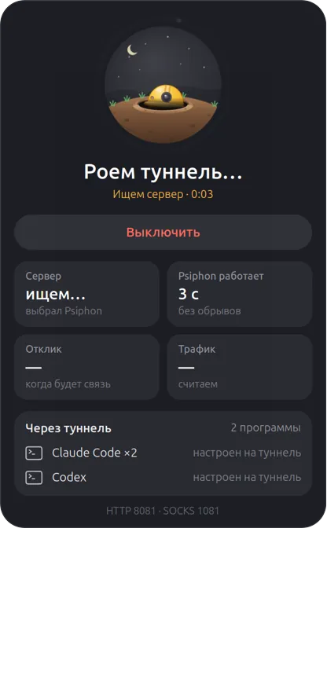
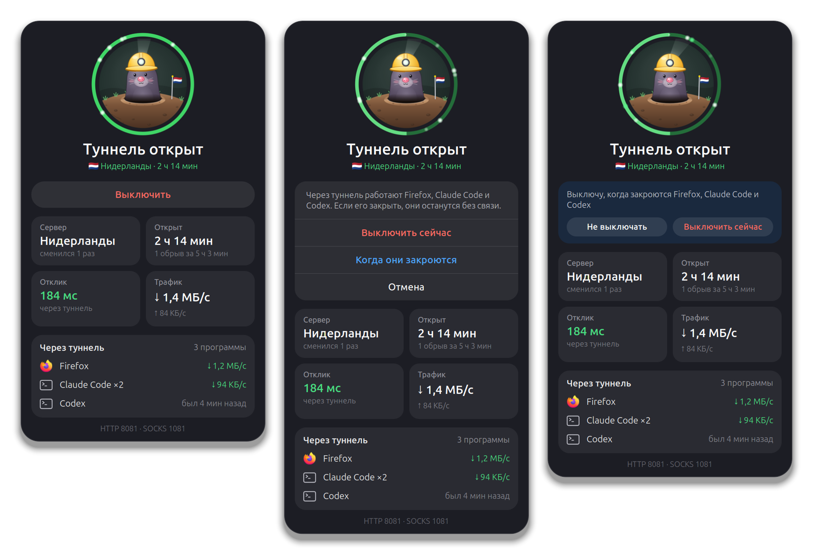

# Psiphon Tunnel

[](https://github.com/lilter96/gnome-psiphon-tunnel/actions/workflows/test.yml)

A GNOME Shell extension that puts the [Psiphon](https://github.com/Psiphon-Labs/psiphon-tunnel-core)
console client in the top bar. A mole in a miner's helmet digs the tunnel. It
sleeps while Psiphon is off, digs while Psiphon looks for a server, and stands
in the open with its lamp on once the tunnel is up. The popup shows the
server's country, how long the tunnel has held, the latency through it, the
traffic and the programs that go through it.

It starts Psiphon the same way the usual pair of shell aliases does, and it
takes care when closing it. If programs are still using the tunnel, it names
them and offers to wait until they are gone.

<p align="center">
  
</p>




<sub>Rendered at 2× in a throwaway headless GNOME Shell by
[`tools/media/capture.sh`](tools/media/capture.sh) against a fake Psiphon
([`tests/fake-psiphon.c`](tests/fake-psiphon.c)). The programs in the list are
made up. The UI text is Russian.</sub>

## Starting

The extension expects the layout these aliases use:

```sh
alias psi-on='nohup ~/psiphon/psiphon -config ~/psiphon/client.conf > ~/psiphon/psiphon.log 2>&1 & echo $! > ~/psiphon/psiphon.pid'
alias psi-off='kill $(cat ~/psiphon/psiphon.pid)'
```

**"Включить" (turn on) runs exactly that.** It uses the same binary, config,
log and pid file, from the home directory, so the aliases keep working: `psi-off`
stops a tunnel the extension started. Before starting, it checks that no other
program is listening on the ports in `client.conf`, and says which port is taken
if one is. Psiphon gets no `*_proxy` variables, so it never tries to reach its
servers through itself.

**Psiphon outlives the Shell.** It runs in a systemd scope of its own
(`app-psiphon-tunnel-<n>.scope`, the way GNOME starts apps) and in its own
session. Without that it would sit in the Shell's cgroup. The Shell's unit has
`KillMode=control-group`, so a Shell crash would take the tunnel down with it.
Turning the extension off never stops Psiphon either. The lock screen and a
Shell restart both turn extensions off, and the tunnel has to survive them.

**A Psiphon started from a terminal is picked up.** The extension takes a process
for its Psiphon only when it runs the same binary with the same config. A
relative `-config` is resolved against the process's working directory. Another
Psiphon on the same machine, with its own binary or config, is never touched.

**For the terminal, [`bin/psi`](bin/psi) is a safer pair.** Install it as
`psi-on` and `psi-off`:

```sh
install -m 755 bin/psi ~/.local/bin/psi
ln -s psi ~/.local/bin/psi-on
ln -s psi ~/.local/bin/psi-off
```

The aliases above have two problems. Run `psi-on` twice and it starts a second
Psiphon on ports the first one holds, wipes the first one's log and puts its
own pid in the pid file. `psi-off` then signals whatever process has that pid
and returns at once. The script does what the extension does instead. `psi-on`
says so if Psiphon already runs, refuses a taken port without touching the log,
and starts Psiphon in its own session and scope. `psi-off` stops only a process
that runs this binary with this config. It waits for that process to exit, and
kills it after 5 seconds if it hangs. Either one can stop what the other
started.

## Closing it gracefully

**Nobody using the tunnel:** "Выключить" (turn off) stops Psiphon straight away.

**Somebody using it:** the button first looks for the programs that would lose
their connection and asks what to do:

- **Выключить сейчас** (turn off now) closes the tunnel anyway.
- **Когда они закроются** (when they close) waits. A banner says whom it waits
  for, and the helmet in the top bar gets a small clock. Programs that start
  using the tunnel during the wait join the list. Once every one of them has
  exited, the tunnel closes and a notification says so. The list is kept as
  process ids with their start times, so the wait survives a Shell restart and
  the lock screen. If someone else stops or restarts Psiphon meanwhile, the wait
  is dropped.
- **Отмена** (cancel).

**How it stops:** SIGTERM to every process running this binary with this
config. Psiphon closes its tunnels and writes an `Exiting` notice. If one of
them is still there after 5 seconds, it gets SIGKILL. The pid file is removed if
it named one of them. The popup then says how it went, for example "Закрыт
аккуратно за 0,1 с" (closed cleanly in 0.1 s), or that Psiphon had to be killed.

**When Psiphon dies on its own,** the extension can tell. A Psiphon that exits
without the `Exiting` notice has crashed, and the popup and a notification say
"Psiphon упал" (Psiphon crashed). The notification has a "Запустить снова"
(start again) button. A stop with `psi-off` writes the notice, so it reads as a
normal stop. A crash behind the lock screen is caught too, once the extension
comes back. Within the same boot, it remembers which Psiphon was running.

## Who goes through the tunnel

A program counts if it has an established TCP connection to one of the tunnel's
ports, like a browser set to the SOCKS port. A program also counts if its
environment points `http_proxy`, `https_proxy` or `all_proxy` at those ports,
like CLI tools started from a wrapper that sets them. These count even while
idle, marked "настроен на туннель" (set to use the tunnel), because their next
request will need it.

Child processes are folded into their parent: a CLI tool's shells and helpers
show up as the tool. Known programs get a readable name and their window icon,
and CLI tools get a terminal icon. A program caught connected once counts until
it exits.

**Traffic** is read from the kernel's per-socket counters (`ss -ti`), as the
difference between two looks. It is the traffic between your programs and
Psiphon, not Psiphon's encrypted traffic to its server. Sockets are sampled
every second while the popup is open, every 3 seconds while waiting to close,
and every 10 seconds otherwise.

## Data

- **Where it lives:** `~/.local/state/psiphon-tunnel/state.json` holds the
  pending stop and the last Psiphon seen running (pid, start time, boot id).
- **What it reads:** from `client.conf`, the two ports and `EgressRegion` only.
  It also reads Psiphon's notices from `psiphon.log` and the process list from
  `/proc`, including your own processes' environments. Those are only checked
  for proxy variables, never stored.
- **Network:** a `HEAD` request to `https://www.gstatic.com/generate_204`
  through the tunnel's HTTP port, twice every 30 seconds. The first request
  opens the connection, and the second one is timed. It runs only while the
  popup is open and the tunnel is up. Nothing else.

## Install

Needs GNOME Shell 46 and Psiphon's console client set up as above.

```sh
git clone https://github.com/lilter96/gnome-psiphon-tunnel
ln -s "$PWD/gnome-psiphon-tunnel/psiphon-tunnel@terentiy" ~/.local/share/gnome-shell/extensions/
gnome-extensions enable psiphon-tunnel@terentiy
```

Then restart the Shell: Alt+F2 → `r` on X11, or log out and back in on Wayland.
A running Psiphon is picked up as it is.

## Development

```sh
gjs -m tests/run.js                  # log parsing, sockets, start/stop and bin/psi against a fake Psiphon
gjs -m tools/frames.js out.png 2     # the mole in every state, no Shell restart
gjs -m tools/glyph.js out.png        # the top bar item, large
tools/media/capture.sh smoke         # a copy of the real Psiphon in an isolated Shell
tools/media/capture.sh media         # README media against the fake Psiphon
```

The process tests compile [`tests/fake-psiphon.c`](tests/fake-psiphon.c), which
takes `-config`, listens on the config's port, writes Psiphon-style notices and
says goodbye on SIGTERM. Knobs in the environment make it ignore SIGTERM or
crash. Each test gets its own directory and random ports, and `bin/psi` is
pointed at it with `PSI_DIR`.

Both captures start a throwaway `gnome-shell --headless` with its own bus, dconf,
XDG directories and `$HOME`. The smoke test copies your Psiphon binary and
config there, moves the ports to 18081 and 11081, and goes through the whole
cycle: start, a curl download, the stop question, a Shell restart while waiting,
a crash and a busy port. Your own Psiphon keeps running throughout, and at the
end the script checks that it is still there, that your dconf is untouched and
that your desktop icons process was not restarted. `--mode=user` is deliberate:
the Ubuntu mode loads Desktop Icons NG, whose `init()` kills the desktop icons
process of your real session.

## Limitations

- The UI is in Russian only.
- The paths are fixed: `~/psiphon/{psiphon,client.conf,psiphon.log,psiphon.pid}`.
  There are no settings.
- Tested on GNOME 46 under X11 with Psiphon's console client.
- A program set to use the tunnel some other way, such as a proxy in its own
  settings, is seen only once it connects.

A sibling of [gnome-dota-time](https://github.com/lilter96/gnome-dota-time) and
[gnome-headphones-battery](https://github.com/lilter96/gnome-headphones-battery):
the same spring animation and the same approach to a character.

## License

[MIT](LICENSE)
